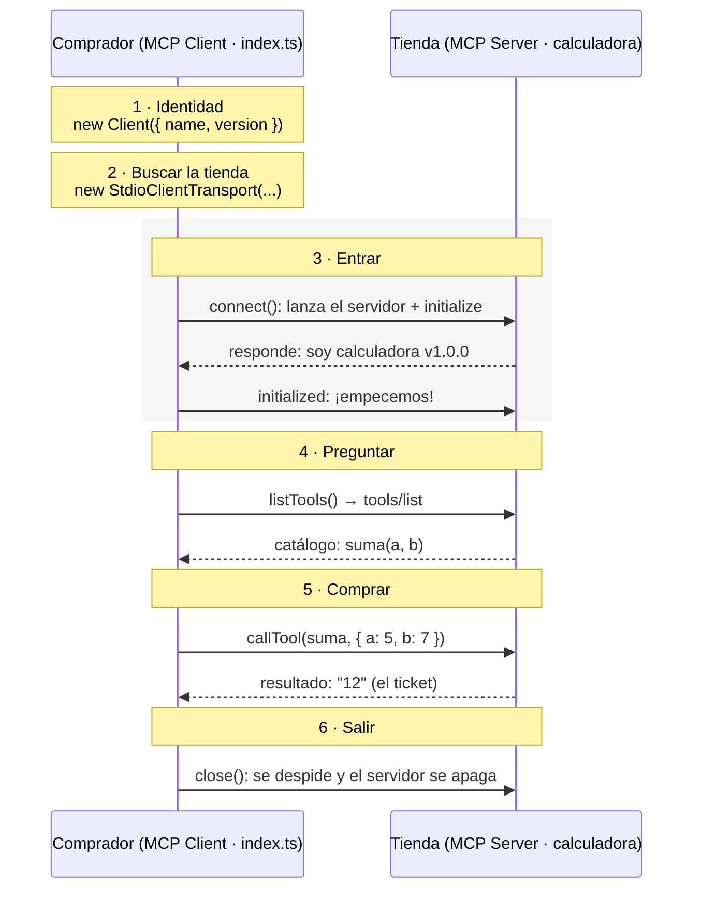

# Guía: cómo construir un MCP Client (la analogía del comprador)

## La idea en una frase

Un MCP Client es una persona con identidad propia que sale a buscar una tienda (el MCP Server), entra, pregunta qué vende y compra lo que necesita. Esta guía construye ese cliente en TypeScript, paso a paso, usando el proyecto `mcp_client` y el servidor `calculadora` de la carpeta `mcp`.

**MCP (Model Context Protocol)** es un idioma común para que un programa (normalmente una IA) use herramientas externas. Siempre hay dos lados:

- **Servidor MCP = la tienda.** Tiene un escaparate con productos: *tools* (acciones, como `suma`), *resources* (datos para leer) y *prompts* (plantillas listas). El servidor `calculadora` ya existe y vende la herramienta `suma`.
- **Cliente MCP = el comprador.** No sabe sumar por sí mismo; sabe encontrar la tienda, hablar su idioma y pedirle cosas. Es lo que vamos a construir.

La historia del comprador tiene seis momentos, y cada uno es un bloque de código: tener identidad, buscar la tienda, entrar, preguntar qué hay, comprar y salir.

## Mapa de la analogía



Los pasos 1 y 2 ocurren "en casa"; del 3 al 6 se habla con la tienda. Flechas continuas: el cliente pide. Flechas discontinuas: la tienda responde.

| Paso | En la historia | En el código |
| --- | --- | --- |
| 1 | La persona tiene DNI | `new Client({ name, version })` |
| 2 | Sabe la dirección de la tienda | `new StdioClientTransport({ command, args })` |
| 3 | Entra y se presenta | `client.connect(transport)` |
| 4 | Pide el catálogo | `client.listTools()` |
| 5 | Compra y recibe el ticket | `client.callTool({ name, arguments })` |
| 6 | Se despide y sale | `client.close()` |

## Paso 0: preparar al comprador antes de salir de casa

Antes de ir de compras, la persona necesita un cuerpo, ropa y un idioma. En código eso es Node.js, un proyecto npm, TypeScript y el SDK de MCP.

### 0.1 Requisito previo: Node.js 20 o superior

Node.js es el "cuerpo" que ejecuta JavaScript fuera del navegador. El SDK de cliente pide Node 20 o más. Compruébalo con:

```bash
node -v
```

### 0.2 Crear el proyecto

```bash
mkdir mcp_client
cd mcp_client
npm init -y
```

`npm init -y` crea `package.json`, el "DNI" del proyecto: nombre, versión, dependencias y scripts.

### 0.3 Instalar dependencias

```bash
npm install @modelcontextprotocol/client
npm install -D typescript @types/node
```

| Paquete | Qué es en la analogía | Para qué sirve |
| --- | --- | --- |
| `@modelcontextprotocol/client` | El idioma de las tiendas MCP | Trae la clase `Client` y los transportes (`StdioClientTransport`, `StreamableHTTPClientTransport`). Sin él tendrías que escribir a mano los mensajes JSON-RPC. |
| `typescript` (dev) | Un traductor que revisa tu lista de la compra | Comprueba los tipos antes de ejecutar y compila `.ts` a `.js`. Es `-D` porque solo se usa al programar, no en producción. |
| `@types/node` (dev) | El manual de Node para TypeScript | Permite que TypeScript entienda `process`, `console`, `child_process`, etc. |
| `tsx` (vía `npx`, opcional) | Un atajo para salir sin cambiarse de ropa | Ejecuta archivos `.ts` directamente sin compilar. Lo usamos para arrancar el servidor y para probar rápido el cliente. |

El `package.json` también tiene `@anthropic-ai/sdk` y `dotenv`. No hacen falta para el cliente básico; sirven para el último paso, cuando un modelo de Claude decide qué comprar.

### 0.4 Configurar el proyecto como módulo ES

En `package.json` añade:

```json
"type": "module"
```

**Por qué:** el SDK se publica como módulos ES, así que usamos `import` en vez de `require`.

### 0.5 Configurar TypeScript (`tsconfig.json`)

```json
{
  "compilerOptions": {
    "target": "ES2022",
    "module": "Node16",
    "moduleResolution": "Node16",
    "types": ["node"],
    "outDir": "./build",
    "rootDir": "./",
    "strict": true,
    "esModuleInterop": true,
    "skipLibCheck": true
  },
  "include": ["index.ts"]
}
```

- `module` y `moduleResolution: "Node16"`: hacen que TypeScript entienda las rutas del SDK como `@modelcontextprotocol/client/stdio`.
- `target: "ES2022"`: permite `await` moderno y sintaxis actual.
- `outDir: "./build"`: el JavaScript compilado va a `build/`.
- `strict: true`: TypeScript te avisa de errores antes de ejecutar.

## Paso 1: darle identidad a la persona

El comprador necesita un nombre y una versión para presentarse en la tienda. Eso es crear el objeto `Client`.

```ts
import { Client } from "@modelcontextprotocol/client";

const client = new Client({
  name: "mi-cliente-calculadora",
  version: "1.0.0",
});
```

- **Qué hace:** crea a la persona, pero todavía está en casa. No hay conexión con nadie.
- **Por qué nombre y versión:** al entrar, el cliente se los dice al servidor. El servidor los usa para registros (logs) y para saber con quién habla, como cuando un dependiente pregunta "¿a nombre de quién?".
- **Analogía:** es el DNI de la persona. Sin él, la tienda no sabe quién entra.

## Paso 2: buscar la tienda (el transporte)

El transporte es la dirección de la tienda y el medio para llegar. Le dice al cliente dónde está el servidor y por qué "camino" viajan los mensajes.

```ts
import { StdioClientTransport } from "@modelcontextprotocol/client/stdio";

const transport = new StdioClientTransport({
  command: "npx",
  args: ["tsx", "C:/Users/el_se/Documents/Neoland/octubre2026/mcp/src/index.ts"],
});
```

- **Qué hace:** describe cómo arrancar la tienda. `command` + `args` es el comando que se ejecutaría en la terminal: `npx tsx .../mcp/src/index.ts`.
- **Por qué stdio:** el servidor usa `serveStdio`, así que habla por la entrada y salida estándar (stdin/stdout). El cliente debe usar el transporte equivalente.
- **Analogía:** con stdio, la tienda es un puesto que el propio comprador monta al llegar. El cliente lanza el proceso del servidor como "hijo" y le habla al oído. Por eso **no** debes arrancar el servidor a mano en otra terminal.
- **Si el servidor ya está compilado:** usa `command: "node", args: ["ruta/al/build/index.js"]`. Es más rápido que `tsx`.

> Ajusta la ruta del `args` a donde esté el servidor en tu ordenador.

### La otra opción: una tienda en la calle (HTTP)

Si el servidor está publicado en una URL, la tienda ya existe y solo vas a su dirección:

```ts
import { StreamableHTTPClientTransport } from "@modelcontextprotocol/client";

const transport = new StreamableHTTPClientTransport(new URL("http://localhost:3000/mcp"));
```

| Transporte | La tienda es… | ¿Quién la arranca? | Cuándo usarlo |
| --- | --- | --- | --- |
| `StdioClientTransport` | Un puesto que montas tú al llegar | El cliente, como proceso hijo | Servidor local, como `calculadora` |
| `StreamableHTTPClientTransport` | Un local con dirección fija | Otra persona, ya está abierto | Servidor remoto o compartido |

## Paso 3: entrar a la tienda (connect)

Una sola línea hace que el comprador llegue, cruce la puerta y salude.

```ts
await client.connect(transport);
console.log("¡Conexión establecida con el servidor MCP!");

const info = client.getServerVersion();
console.log(`Estoy en la tienda: ${info?.name} v${info?.version}`);
```

Por dentro, `connect` hace tres cosas:

1. **Arranca la tienda** (solo con stdio): lanza `npx tsx .../index.ts` como proceso hijo.
2. **Saludo de presentación (`initialize`):** el cliente dice "soy `mi-cliente-calculadora` v1.0.0 y hablo esta versión del protocolo". El servidor responde "soy `calculadora` v1.0.0 y sé hacer esto (capabilities)".
3. **Confirmación (`initialized`):** el cliente dice "perfecto, empecemos". A partir de aquí ya puede pedir cosas.

- **Por qué `await`:** el saludo es una conversación de ida y vuelta. Si preguntas antes de que termine, la tienda aún no te ha atendido.
- **`getServerVersion()` y `getServerCapabilities()`:** te dejan leer el cartel de la puerta: el nombre de la tienda y qué secciones tiene (tools, resources, prompts).

## Paso 4: preguntar qué ofrecen (listTools)

Dentro de la tienda, el comprador pide el catálogo. El cliente no adivina qué herramientas existen: las descubre.

```ts
const { tools } = await client.listTools();
console.log("Herramientas descubiertas:");
tools.forEach((tool) => console.log(`- ${tool.name}: ${tool.description}`));
```

Con el servidor `calculadora` verás:

```text
- suma: suma 2 numeros
```

Cada herramienta trae una ficha de producto:

- `name`: cómo pedirla (`"suma"`).
- `description`: para qué sirve. Una IA la lee para decidir si la usa.
- `inputSchema`: qué datos necesita (aquí `a` y `b`, ambos números). Viene del `z.object(...)` del servidor convertido a JSON Schema.

**Por qué preguntar en vez de llamar directamente:** el mismo cliente sirve para cualquier tienda. Si mañana el servidor añade `resta`, el cliente la ve sin cambiar código. Esto es clave cuando conectes un LLM: le pasas este catálogo y él elige.

Las tiendas pueden tener otras secciones. Pregúntalas solo si `getServerCapabilities()` dice que existen:

| Sección | Método para ver el catálogo | Analogía |
| --- | --- | --- |
| Tools | `client.listTools()` | Servicios: "te hago una suma" |
| Resources | `client.listResources()` | Folletos e información para leer |
| Prompts | `client.listPrompts()` | Menús o combos ya preparados |

`calculadora` solo registra tools, así que llamar a `listResources()` daría error.

## Paso 5: comprar y leer el ticket (callTool)

El comprador elige un producto del catálogo, dice qué quiere exactamente y recibe su compra con un ticket.

```ts
const result = await client.callTool({
  name: "suma",
  arguments: { a: 5, b: 7 },
});

result.content.forEach((block) => {
  if (block.type === "text") {
    console.log(`El resultado devuelto es: ${block.text}`);
  }
});
```

- **`name`:** el producto, tal como sale en `listTools()`. Si te equivocas de nombre, la tienda responde "no tenemos eso".
- **`arguments`:** los detalles del pedido. Deben cumplir el `inputSchema`: si mandas `a: "5"` (texto), el servidor lo rechaza porque Zod espera un número.
- **`result.content`:** la bolsa con lo comprado. Es una lista de bloques porque una herramienta puede devolver texto, imágenes o enlaces a la vez. `suma` devuelve un bloque de texto con `"12"`.
- **`result.isError`:** si es `true`, la tienda te atendió pero el servicio falló (por ejemplo, división por cero). Revísalo antes de usar el resultado.
- **Por qué el resultado es texto `"12"` y no el número 12:** MCP está pensado para que lo lea una IA, y el formato universal es texto. Si lo necesitas como número, usa `Number(block.text)`.

Las otras secciones se compran igual:

```ts
await client.readResource({ uri: "file:///notas.txt" });              // leer un folleto
await client.getPrompt({ name: "resumen", arguments: { tema: "MCP" } }); // pedir un combo
```

## Paso 6: salir de la tienda (close) y qué hacer si algo falla

Al terminar, el comprador se despide y sale. Con stdio, al salir también se desmonta el puesto: `close()` detiene el proceso del servidor.

```ts
await client.close();
```

**Por qué importa:** si no cierras, el proceso hijo del servidor puede quedarse vivo y tu programa no termina.

Para salir siempre, aunque algo falle a mitad de la compra, usa `try / finally`:

```ts
try {
  await client.connect(transport);
  // ... listTools, callTool ...
} catch (error) {
  console.error("Algo salió mal en la tienda:", error);
} finally {
  await client.close();
}
```

| Qué pasa | En la analogía | Dónde lo ves |
| --- | --- | --- |
| La ruta del servidor está mal | La tienda no existe en esa dirección | `connect` lanza error |
| Nombre de herramienta incorrecto | Pides un producto que no venden | `callTool` lanza error |
| Argumentos de tipo incorrecto | Pides talla "azul" | Error de validación en `callTool` |
| La herramienta falla por dentro | Te atienden pero el servicio sale mal | `result.isError === true` |

## El recorrido completo: index.ts

Este es `index.ts` con los seis momentos marcados y el `try / finally` añadido.

```ts
import { Client } from "@modelcontextprotocol/client";
import { StdioClientTransport } from "@modelcontextprotocol/client/stdio";

async function runClient() {
  // 1. IDENTIDAD: la persona tiene nombre y versión
  const client = new Client({
    name: "mi-cliente-calculadora",
    version: "1.0.0",
  });

  // 2. BUSCAR LA TIENDA: cómo llegar al servidor
  const transport = new StdioClientTransport({
    command: "npx",
    args: ["tsx", "C:/Users/el_se/Documents/Neoland/octubre2026/mcp/src/index.ts"],
  });

  try {
    // 3. ENTRAR: arranca el servidor y hace el saludo initialize
    await client.connect(transport);
    const info = client.getServerVersion();
    console.log(`Dentro de la tienda: ${info?.name} v${info?.version}`);

    // 4. PREGUNTAR: ¿qué vendéis?
    const { tools } = await client.listTools();
    console.log("Herramientas descubiertas:");
    tools.forEach((tool) => console.log(`- ${tool.name}: ${tool.description}`));

    // 5. COMPRAR: usar la herramienta "suma"
    console.log("\nLlamando a 'suma' con 5 y 7...");
    const result = await client.callTool({
      name: "suma",
      arguments: { a: 5, b: 7 },
    });

    if (result.isError) {
      console.error("La herramienta devolvió un error", result.content);
    } else {
      result.content.forEach((block) => {
        if (block.type === "text") {
          console.log(`El resultado devuelto es: ${block.text}`);
        }
      });
    }
  } finally {
    // 6. SALIR: cerrar la conexión y detener el servidor
    await client.close();
  }
}

runClient().catch(console.error);
```

### Cómo ejecutarlo

Opción rápida, sin compilar (ideal mientras aprendes):

```bash
npx tsx index.ts
```

Opción compilada, como en producción:

```bash
npx tsc
node build/index.js
```

Para no recordar comandos, añade a `scripts` en `package.json`:

```json
"start": "tsx index.ts"
```

y ejecuta `npm start` (instala antes `npm install -D tsx`).

Salida esperada:

```text
Weather MCP Server running on stdio
Dentro de la tienda: calculadora v1.0.0
Herramientas descubiertas:
- suma: suma 2 numeros

Llamando a 'suma' con 5 y 7...
El resultado devuelto es: 12
```

La primera línea la imprime el servidor por `stderr`. Aparece en tu terminal porque el transporte stdio deja pasar los mensajes de error del proceso hijo.

## Errores frecuentes y siguiente paso

| Síntoma | Causa probable | Solución |
| --- | --- | --- |
| `Cannot find module '@modelcontextprotocol/client/stdio'` | `tsconfig` sin `"module": "Node16"` o falta `npm install` | Revisa los pasos 0.3 y 0.5 |
| `Cannot use import statement outside a module` | Falta `"type": "module"` en `package.json` | Añádelo (paso 0.4) |
| El programa se queda colgado al final | No se llamó a `client.close()` | Usa `try / finally` (paso 6) |
| `Connection closed` justo al conectar | La ruta del servidor está mal o el servidor falla al arrancar | Prueba `npx tsx <ruta>` a mano y lee el error |
| Mensajes raros mezclados con la respuesta | El servidor usa `console.log` en vez de `console.error` | En un servidor stdio, `stdout` es solo para MCP: los logs van a `console.error` |
| Arranque lento la primera vez | `npx tsx` descarga `tsx` si no está instalado | `npm install -D tsx` en la carpeta del servidor |

### Siguiente paso: que una IA decida qué comprar

Hasta ahora, tú decides que el comprador pida `suma(5, 7)`. El paso natural es darle el catálogo a un modelo de Claude y dejar que él elija:

1. Llama a `client.listTools()` y convierte cada herramienta a `{ name, description, input_schema }`.
2. Envía la pregunta del usuario y esas herramientas a Claude con `@anthropic-ai/sdk` (la API key va en `.env`, que carga `dotenv`).
3. Si Claude responde con un bloque `tool_use`, ejecuta `client.callTool()` con ese nombre y esos argumentos.
4. Devuelve el resultado a Claude como `tool_result` y repite hasta que conteste en texto.

En la analogía, la persona pasa a tener un asistente personal: el asistente lee el catálogo y decide; el comprador solo hace el recado.
