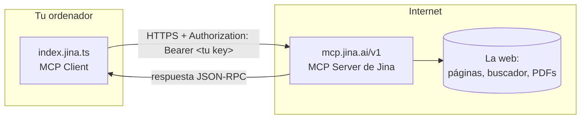
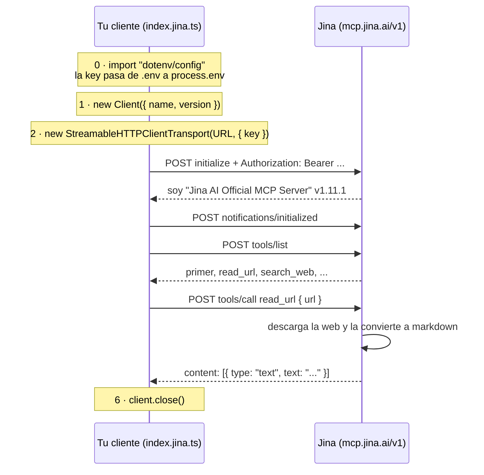

# Guía 2: conectar tu MCP Client a un servidor externo (Jina AI)

## La idea en una frase

En la primera guía el comprador montaba su propio puesto (stdio, un servidor en tu ordenador). Ahora va a **una tienda de verdad que está en la calle**: un servidor MCP que vive en internet, que otra empresa mantiene abierto y que solo deja pasar a quien enseña su **tarjeta de socio** (una API key).

Esa tienda es el **servidor MCP oficial de Jina AI** (`https://mcp.jina.ai/v1`). Vende herramientas para que una IA lea páginas web, busque en Google, haga capturas de pantalla, lea PDFs, etc.

Al terminar sabrás:

- Qué cambia entre un servidor **local** y uno **remoto**, y cuándo usar cada uno.
- Cómo conseguir una **API key** y guardarla de forma segura en `.env`.
- Las **tres formas** de mandar esa key desde el código, y cuál elegir.
- Cómo **probar** cada pieza por separado para saber qué falla cuando algo falla.

> Si no has hecho la primera guía ([GUIA_MCP_CLIENT.md](GUIA_MCP_CLIENT.md)), léela antes: aquí damos por sabidos `Client`, `connect`, `listTools` y `callTool`.

---

## 1. Local vs remoto: dos tipos de tienda



| | Servidor local (guía 1) | Servidor remoto (esta guía) |
| --- | --- | --- |
| Dónde vive | En tu ordenador | En un servidor de otra empresa |
| Quién lo arranca | Tu cliente, como proceso hijo | Ya está encendido 24/7 |
| Transporte | `StdioClientTransport` | `StreamableHTTPClientTransport` |
| Cómo se llega | Un comando (`npx tsx ruta.ts`) | Una URL (`https://...`) |
| Identificación | No hace falta: es tuyo | **API key** en cada petición |
| Necesita internet | No | Sí |
| Coste | Gratis | Según el proveedor (Jina tiene tokens gratis) |

**Cuándo usar uno remoto:**

- Cuando la herramienta la ofrece otra empresa (Jina, GitHub, Notion, Stripe...) y no quieres programarla tú.
- Cuando varias personas o apps tienen que usar **el mismo** servidor.
- Cuando tu app se despliega en la nube y no puede lanzar procesos locales.

**Cuándo seguir con uno local:** cuando la herramienta es tuya, toca archivos de tu ordenador o estás aprendiendo/depurando sin internet.

---

## 2. Requisitos e instalación (desde cero)

Si ya tienes el proyecto de la guía 1, solo te falta el **paso 2.4** (`dotenv`) y el **2.5** (`tsx`). Aun así, revisa todos.

### 2.1 Node.js 20 o superior

**Qué es:** el programa que ejecuta JavaScript/TypeScript fuera del navegador.
**Por qué ≥ 20:** el SDK de MCP lo exige, y además usamos `fetch` y `Headers` nativos, que vienen incluidos en Node moderno.

Instalación: descarga la versión **LTS** de <https://nodejs.org> y sigue el instalador (siguiente, siguiente...). Cierra y vuelve a abrir la terminal.

**Pruébalo:**

```bash
node -v   # debe mostrar v20.x o superior (por ejemplo v24.22.0)
npm -v    # npm se instala junto con Node
```

Si dice `node no se reconoce como un comando`, reinicia la terminal (o el ordenador) para que se cargue el PATH.

### 2.2 Crear el proyecto

```bash
mkdir mcp_client
cd mcp_client
npm init -y
```

**Qué hace:** crea `package.json`, la ficha del proyecto (nombre, dependencias, scripts).

Abre `package.json` y añade:

```json
"type": "module"
```

**Por qué:** el SDK usa módulos ES (`import ... from`). Sin esto verás `Cannot use import statement outside a module`.

### 2.3 El SDK de cliente MCP

```bash
npm install @modelcontextprotocol/client
```

**Qué trae:** la clase `Client` y el transporte `StreamableHTTPClientTransport`, que sabe hablar MCP por HTTP: empaqueta tus peticiones en JSON-RPC, las manda por `POST`, entiende las respuestas (JSON o streaming) y gestiona la sesión.

**Pruébalo:**

```bash
npm ls @modelcontextprotocol/client
# mcp_client@1.0.0
# └── @modelcontextprotocol/client@2.4.0
```

### 2.4 dotenv: leer secretos desde un archivo

```bash
npm install dotenv
```

**Qué es:** una librería que lee el archivo `.env` y mete cada línea en `process.env`.
**Por qué la necesitamos:** la API key es una contraseña. **Nunca** se escribe dentro del código, porque el código se sube a GitHub y cualquiera la vería (y gastaría tus créditos).

**Pruébalo** (después de crear el `.env` del paso 3):

```bash
node -e "require('dotenv').config(); console.log(process.env.jinaApiKey ? 'key cargada OK' : 'NO hay key')"
```

> Este comando usa `require` porque `node -e` no lee el `"type": "module"`. En tu código usarás `import "dotenv/config"`.

### 2.5 TypeScript y tsx

```bash
npm install -D typescript @types/node tsx
```

| Paquete | Para qué |
| --- | --- |
| `typescript` | Revisa los tipos y compila `.ts` → `.js` (`npx tsc`). |
| `@types/node` | Le enseña a TypeScript qué son `process`, `fetch`, `URL`... |
| `tsx` | Ejecuta un `.ts` **directamente**, sin compilar. Ideal mientras aprendes. |

`-D` significa "dependencia de desarrollo": solo se usan mientras programas.

**Pruébalo:**

```bash
npx tsc -v   # Version 7.x
npx tsx -v   # tsx v4.x
```

### 2.6 tsconfig.json

```json
{
  "compilerOptions": {
    "target": "ES2022",
    "module": "Node16",
    "moduleResolution": "Node16",
    "types": ["node"],
    "outDir": "./build",
    "rootDir": "./",
    "strict": true,
    "esModuleInterop": true,
    "skipLibCheck": true
  },
  "include": ["index.ts", "index.jina.ts"]
}
```

**Ojo:** si quieres compilar `index.jina.ts` con `npx tsc`, tiene que estar en `include`. Si solo usas `npx tsx index.jina.ts`, da igual.

---

## 3. Conseguir la tarjeta de socio: la API key de Jina

### 3.1 Qué es una API key y por qué existe

Una **API key** es una cadena larga (`jina_xxxxxxxx...`) que identifica a tu cuenta. El servidor la usa para:

1. **Saber quién eres** (autenticación).
2. **Contar lo que gastas** (Jina descuenta tokens por cada página leída o búsqueda).
3. **Ponerte límites** para que nadie abuse del servicio.

**Qué pasa sin ella:** lo comprobamos de verdad. La conexión funciona y puedes listar herramientas, pero al usarlas Jina responde con un error:

```text
isError: true
"Please set your API key in the Jina AI MCP settings. You can get a free API key by visiting https://jina.ai ..."
```

### 3.2 Cómo obtenerla

1. Entra en <https://jina.ai>.
2. Crea una cuenta (con Google o email).
3. Busca la sección **API Key** (en la página principal o en el panel de tu cuenta) y copia la key. Las cuentas nuevas traen tokens gratis.

### 3.3 Guardarla en `.env`

Crea un archivo llamado exactamente `.env` en la raíz del proyecto:

```env
jinaApiKey=jina_pega_aqui_tu_key
```

Reglas del `.env`:

- Sin espacios alrededor del `=` y sin comillas.
- Una variable por línea.
- El nombre (`jinaApiKey`) es el que usarás en el código: `process.env.jinaApiKey`. Si lo escribes distinto en un sitio y otro, llegará `undefined`.

### 3.4 Que `.env` nunca llegue a GitHub

En `.gitignore`:

```gitignore
node_modules
.env
```

**Pruébalo:**

```bash
git check-ignore .env      # si imprime ".env", está protegido
git status                 # .env NO debe aparecer en la lista
```

Si alguna vez subes una key por error: **revócala en el panel de Jina y crea otra**. Borrar el commit no basta, porque ya quedó en el historial.

> Buena práctica: crea un `.env.example` con `jinaApiKey=` (sin valor) y súbelo. Así tus compañeros saben qué variables necesitan.

---

## 4. Probar la tienda antes de escribir código

Antes de programar, comprueba que la tienda existe y que tu tarjeta funciona. Así, si luego algo falla, sabrás que el problema está en tu código y no en la conexión o la key.

### 4.1 Con MCP Inspector (visual, recomendado)

El **MCP Inspector** es una web oficial para conectarte a cualquier servidor MCP y probar sus herramientas con botones.

```bash
npx @modelcontextprotocol/inspector
```

Se abrirá el navegador. Rellena:

| Campo | Valor |
| --- | --- |
| Transport Type | `Streamable HTTP` |
| URL | `https://mcp.jina.ai/v1` |
| Authentication → Header | `Authorization` |
| Authentication → Value | `Bearer jina_tu_key` |

Pulsa **Connect** → pestaña **Tools** → **List Tools**. Elige `read_url`, escribe una URL y pulsa **Run Tool**.

**Cuándo usarlo:** siempre que conectes con un servidor nuevo, para ver nombres exactos de herramientas y qué parámetros piden, sin escribir una línea de código.

### 4.2 Con la terminal (para entender qué viaja por la red)

MCP por HTTP no es magia: son peticiones `POST` con JSON. Este es el saludo `initialize` que hace `client.connect()` por dentro.

**PowerShell (Windows):**

```powershell
$key = "jina_tu_key"
curl.exe -s https://mcp.jina.ai/v1 `
  -H "Authorization: Bearer $key" `
  -H "Content-Type: application/json" `
  -H "Accept: application/json, text/event-stream" `
  -d '{\"jsonrpc\":\"2.0\",\"id\":1,\"method\":\"initialize\",\"params\":{\"protocolVersion\":\"2025-06-18\",\"capabilities\":{},\"clientInfo\":{\"name\":\"curl\",\"version\":\"1.0\"}}}'
```

**Git Bash / Mac / Linux:**

```bash
curl -s https://mcp.jina.ai/v1 \
  -H "Authorization: Bearer $JINA_KEY" \
  -H "Content-Type: application/json" \
  -H "Accept: application/json, text/event-stream" \
  -d '{"jsonrpc":"2.0","id":1,"method":"initialize","params":{"protocolVersion":"2025-06-18","capabilities":{},"clientInfo":{"name":"curl","version":"1.0"}}}'
```

Si todo va bien, la respuesta contiene `"serverInfo":{"name":"Jina AI Official MCP Server", ...}`.

Fíjate en las tres cabeceras: son exactamente lo que el SDK añade por ti.

| Cabecera | Por qué |
| --- | --- |
| `Authorization: Bearer <key>` | La tarjeta de socio. `Bearer` significa "el portador de este token". |
| `Content-Type: application/json` | "Te mando JSON". |
| `Accept: application/json, text/event-stream` | "Puedes responderme con JSON normal o en streaming". MCP lo exige. |

---

## 5. El código, paso a paso

Los seis momentos de la guía 1 se mantienen. Lo nuevo está en el **paso 2** (la dirección es una URL) y en el **paso 2b** (enseñar la tarjeta).



### Paso 0: cargar la key

```ts
import "dotenv/config";
```

**Qué hace:** en cuanto se importa, lee `.env` y rellena `process.env`.
**Por qué arriba del todo:** tiene que ejecutarse **antes** de que cualquier línea lea `process.env.jinaApiKey`.

Buena práctica: comprobar que existe y parar si no, con un mensaje claro:

```ts
const apiKey = process.env.jinaApiKey;
if (!apiKey) {
  throw new Error("Falta jinaApiKey en el archivo .env");
}
```

Sin esta comprobación, mandarías literalmente `Bearer undefined` y el error que verías sería mucho más confuso.

### Paso 1: identidad

```ts
import { Client } from "@modelcontextprotocol/client";

const client = new Client({ name: "mi-cliente-jina", version: "1.0.0" });
```

Igual que en la guía 1: el DNI con el que te presentas en la tienda.

### Paso 2: la dirección de la tienda

```ts
import { StreamableHTTPClientTransport } from "@modelcontextprotocol/client";

const jinaEndpoint = new URL("https://mcp.jina.ai/v1");
```

- **`new URL(...)`**: el transporte pide un objeto `URL`, no un texto. Además, si la escribes mal, falla aquí mismo con `Invalid URL`, antes de intentar conectar.
- **¿De dónde sale la URL?** De la documentación del proveedor. Cada servidor remoto publica la suya (busca "MCP server" en la doc de Jina, GitHub, etc.).
- **Streamable HTTP:** es el transporte estándar actual de MCP para servidores remotos. Todo viaja por un único endpoint con `POST`, y el servidor puede responder con JSON o con un stream.

### Paso 2b: enseñar la tarjeta (tres formas)

Este es el punto clave de la guía. El servidor necesita la cabecera `Authorization: Bearer <key>` en **cada** petición. El SDK te da tres maneras de ponerla.

#### Forma A: `authProvider` (recomendada)

```ts
const transport = new StreamableHTTPClientTransport(jinaEndpoint, {
  authProvider: {
    token: async () => apiKey,
  },
});
```

- **Qué hace:** antes de cada petición, el transporte llama a `token()` y añade `Authorization: Bearer <lo que devuelva>`.
- **Por qué es la mejor:** es la forma pensada para esto. Si el servidor responde `401` (no autorizado), el SDK lo detecta y te da un error claro. Y si mañana la key caduca y hay que renovarla, solo cambias la función `token`.
- **Cuándo:** siempre que la autenticación sea un **token Bearer** (la mayoría de APIs: Jina, GitHub, OpenAI...).

#### Forma B: `requestInit.headers` (la más simple de leer)

```ts
const transport = new StreamableHTTPClientTransport(jinaEndpoint, {
  requestInit: {
    headers: {
      Authorization: `Bearer ${apiKey}`,
    },
  },
});
```

- **Qué hace:** le dice al transporte "añade estas cabeceras a todas tus peticiones".
- **Cuándo:** cuando el servidor pide una cabecera **que no es Bearer**, por ejemplo `X-API-Key: ...`. También sirve para Bearer si la key no cambia nunca.

#### Forma C: un `fetch` personalizado (la que usa `index.jina.ts`)

```ts
const transport = new StreamableHTTPClientTransport(jinaEndpoint, {
  fetch: (input, init) => {
    const headers = new Headers(init?.headers);
    headers.set("Authorization", `Bearer ${apiKey}`);
    return fetch(input, { ...init, headers });
  },
});
```

- **Qué hace:** sustituye la función que el transporte usa para hacer peticiones por una tuya. Tu función copia las cabeceras que ya traía (`new Headers(init?.headers)`), añade la tuya y llama al `fetch` real.
- **Por qué `new Headers(...)` y no un objeto `{}`:** `init.headers` puede llegar en tres formatos distintos (objeto, array o `Headers`). `new Headers()` acepta los tres y así no pisas las cabeceras que el SDK necesita (`Content-Type`, `Accept`, `mcp-session-id`...).
- **Cuándo:** cuando necesitas **algo más** que cabeceras: registrar cada petición en consola, medir tiempos, reintentar si falla, usar un proxy...

Ejemplo práctico de la forma C para **ver qué viaja por la red** mientras aprendes:

```ts
fetch: async (input, init) => {
  const headers = new Headers(init?.headers);
  headers.set("Authorization", `Bearer ${apiKey}`);
  console.error("→", init?.method, String(input), init?.body);
  const res = await fetch(input, { ...init, headers });
  console.error("←", res.status);
  return res;
},
```

#### Resumen: cuál elegir

| Forma | Elige esta si... |
| --- | --- |
| A · `authProvider` | El servidor pide `Authorization: Bearer`. **Por defecto.** |
| B · `requestInit.headers` | El servidor pide otra cabecera (`X-API-Key`, etc.). |
| C · `fetch` propio | Necesitas logs, reintentos, proxy u otra lógica por petición. |

> Algunos servidores remotos usan **OAuth** (abren el navegador para que inicies sesión, como "Iniciar sesión con Google"). Eso se hace pasando un `OAuthClientProvider` en `authProvider`; es más complejo y queda fuera de esta guía. Jina usa una key fija, así que no lo necesitas.

### Paso 3: entrar

```ts
await client.connect(transport);
const info = client.getServerVersion();
console.log(`Conectado a: ${info?.name} v${info?.version}`);
```

Diferencia con stdio: aquí `connect` **no arranca nada**. Manda el `initialize` por HTTPS a una tienda que ya estaba abierta. Si falla, normalmente es por la red, la URL o la key (mira la tabla de errores del final).

Salida real:

```text
Conectado a: Jina AI Official MCP Server v1.11.1
```

### Paso 4: preguntar qué venden

```ts
const { tools } = await client.listTools();
tools.forEach((t) => console.log(`- ${t.name}: ${t.description}`));
```

Lo que devuelve Jina hoy:

| Herramienta | Qué hace |
| --- | --- |
| `read_url` | Lee una página web (o PDF) y la devuelve en markdown limpio. |
| `search_web` | Busca en internet y devuelve títulos, URLs y fragmentos. |
| `search_images` | Busca imágenes. |
| `search_arxiv` / `search_ssrn` | Busca artículos científicos. |
| `capture_screenshot_url` | Hace una captura de una web. |
| `extract_pdf` | Extrae contenido de un PDF. |
| `guess_datetime_url` | Estima la fecha de publicación de una página. |
| `sort_by_relevance` / `deduplicate_strings` | Ordena o limpia listas de textos. |
| `primer` | Información de contexto útil para una IA. |

**Por qué listar en vez de memorizar:** el servidor es de otra empresa y **puede cambiar sin avisarte** (añadir, renombrar o quitar herramientas). Listar te dice la verdad de hoy. Por eso el comentario en `index.jina.ts` dice "cambia esto por el nombre exacto si Jina lo llama diferente".

Para ver **qué parámetros** pide una herramienta, imprime su `inputSchema`:

```ts
const readUrl = tools.find((t) => t.name === "read_url");
console.log(JSON.stringify(readUrl?.inputSchema, null, 2));
```

Para `read_url` verás, entre otros: `url` (obligatorio; una URL o hasta 5), `question` (opcional: devuelve solo los fragmentos que responden a esa pregunta), `withAllLinks` y `withAllImages`.

### Paso 5: comprar

```ts
const result = await client.callTool({
  name: "read_url",
  arguments: { url: "https://creanovatech.com/" },
});

if (result.isError) {
  console.error("Jina devolvió un error:", result.content);
} else {
  result.content.forEach((block) => {
    if (block.type === "text") console.log(block.text);
  });
}
```

Salida real (recortada):

```text
url: https://creanovatech.com/
title: Creanovatech | Software a medida, IA y automatización
content: >-
  ## Construimos el software que tu negocio necesita.
  ...
```

**Revisa siempre `isError`.** En un servidor remoto hay más cosas que pueden ir mal (key sin saldo, web caída, límite de peticiones), y muchas llegan como `isError: true`, **no** como excepción. Es lo que pasa si no mandas la key.

Prueba otras compras:

```ts
// Solo la parte que responde a una pregunta (gasta menos tokens)
await client.callTool({
  name: "read_url",
  arguments: { url: "https://creanovatech.com/", question: "¿Qué servicios ofrecen?" },
});

// Buscar en la web: 3 resultados de la última semana, en español
await client.callTool({
  name: "search_web",
  arguments: { query: "Model Context Protocol", num: 3, tbs: "qdr:w", hl: "es" },
});
```

### Paso 6: salir

```ts
await client.close();
```

**Sobre `transport.terminateSession()`:** sirve para decirle al servidor "borra mi sesión". Solo hace algo si el servidor creó una sesión (te habría dado una cabecera `mcp-session-id`). Jina funciona **sin sesión** (`transport.sessionId` es `undefined`), así que en este caso no hace nada. No hace daño dejarlo, pero con `client.close()` basta.

---

## 6. El archivo completo

`index.jina.ts`, con la forma A, la comprobación de la key y `isError`:

```ts
import { Client, StreamableHTTPClientTransport } from "@modelcontextprotocol/client";
import "dotenv/config"; // 0. Carga .env en process.env

async function runJinaClient() {
  // 0b. Comprobar que la tarjeta de socio existe
  const apiKey = process.env.jinaApiKey;
  if (!apiKey) throw new Error("Falta jinaApiKey en el archivo .env");

  // 1. IDENTIDAD
  const client = new Client({ name: "mi-cliente-jina", version: "1.0.0" });

  // 2. DIRECCIÓN + TARJETA: servidor remoto por HTTP con API key
  const transport = new StreamableHTTPClientTransport(
    new URL("https://mcp.jina.ai/v1"),
    { authProvider: { token: async () => apiKey } },
  );

  try {
    // 3. ENTRAR: initialize por HTTPS (no arranca ningún proceso)
    await client.connect(transport);
    const info = client.getServerVersion();
    console.log(`Conectado a: ${info?.name} v${info?.version}`);

    // 4. PREGUNTAR: catálogo de herramientas
    const { tools } = await client.listTools();
    console.log("Herramientas:", tools.map((t) => t.name).join(", "));

    // 5. COMPRAR: leer una web
    const result = await client.callTool({
      name: "read_url",
      arguments: { url: "https://creanovatech.com/" },
    });

    if (result.isError) {
      console.error("Jina devolvió un error:", result.content);
      return;
    }
    result.content.forEach((block) => {
      if (block.type === "text") console.log(block.text);
    });
  } finally {
    // 6. SALIR
    await client.close();
  }
}

runJinaClient().catch((error) => {
  console.error("Error conectando a Jina:", error);
  process.exitCode = 1;
});
```

### Ejecutarlo

```bash
npx tsx index.jina.ts
```

O añade un script en `package.json`:

```json
"scripts": {
  "jina": "tsx index.jina.ts"
}
```

y ejecuta `npm run jina`.

---

## 7. Cómo probar cada pieza (cuando algo no funciona)

Ve de abajo arriba. Cada prueba descarta una causa.

| # | Qué compruebas | Cómo | Resultado bueno |
| --- | --- | --- | --- |
| 1 | Node instalado | `node -v` | `v20` o más |
| 2 | Dependencias instaladas | `npm ls @modelcontextprotocol/client dotenv` | Aparecen ambas con versión |
| 3 | La key se lee | Comando del paso 2.4 | `key cargada OK` |
| 4 | Hay internet y la URL es buena | Navegador o `curl -I https://mcp.jina.ai/v1` | Responde (aunque sea un error 4xx, el servidor existe) |
| 5 | La key es válida | MCP Inspector (4.1) o `curl` (4.2) | Conecta y lista herramientas |
| 6 | Tu código conecta | Comenta todo tras `connect` y ejecuta | `Conectado a: Jina AI...` |
| 7 | Nombre y argumentos | Imprime `tools` e `inputSchema` | El nombre coincide letra a letra |

---

## 8. Errores frecuentes

| Síntoma | Causa probable | Solución |
| --- | --- | --- |
| `Falta jinaApiKey en el archivo .env` | `.env` no existe, está en otra carpeta o el nombre no coincide | El `.env` va en la raíz, junto a `package.json`. Revisa mayúsculas: `jinaApiKey`. |
| Funciona, pero `isError: true` con "Please set your API key" | La key no llega | Revisa el paso 2b. Imprime `apiKey?.slice(0, 8)` para ver que no es `undefined` (nunca imprimas la key entera). |
| `401 Unauthorized` | Key incorrecta, revocada o con espacios | Cópiala de nuevo del panel de Jina. Sin comillas ni espacios en el `.env`. |
| `402` / `429` o mensaje de saldo/límite | Sin tokens o demasiadas peticiones seguidas | Mira tu saldo en jina.ai; espera unos segundos entre llamadas. |
| `fetch failed` / `ENOTFOUND` / `ETIMEDOUT` | Sin internet, URL mal escrita o un firewall/proxy lo bloquea | Prueba la URL en el navegador; prueba otra red. |
| `TypeError: Invalid URL` | La URL no empieza por `https://` | Escríbela completa. |
| `Tool read_url not found` | El nombre cambió | Usa el nombre exacto que salga en `listTools()`. |
| Error de validación en `callTool` | Argumentos que no cumplen el `inputSchema` | Imprime el `inputSchema` (paso 4); por ejemplo, `num` debe ser número entre 1 y 10. |
| `Cannot use import statement outside a module` | Falta `"type": "module"` | Paso 2.2. |
| `npx tsc` no compila `index.jina.ts` | No está en `include` del `tsconfig.json` | Paso 2.6, o usa `npx tsx`. |
| La key aparece en `git status` | `.env` no está en `.gitignore` | Paso 3.4. Si ya la subiste, revócala. |

---

## 9. Lo que te llevas

1. Un **servidor remoto** es una URL; el transporte es `StreamableHTTPClientTransport`.
2. El cliente **no lo arranca**: solo se conecta. Necesitas internet.
3. Casi siempre hace falta **identificarse**: API key en `.env`, cargada con `dotenv`, nunca en el código ni en GitHub.
4. La key se manda en la cabecera `Authorization: Bearer ...`: con `authProvider` (por defecto), `requestInit.headers` (otras cabeceras) o un `fetch` propio (lógica extra).
5. **Lista antes de llamar**: el servidor es de otro y puede cambiar.
6. **Revisa `isError`**: en remoto, muchos fallos llegan como resultado y no como excepción.
7. **Prueba antes de programar** con MCP Inspector o `curl`.

### Siguiente paso

Junta las dos guías: un mismo programa con **dos clientes**, uno a tu `calculadora` local (stdio) y otro a Jina (HTTP). Junta los catálogos de ambos con `listTools()` y pásaselos a Claude con `@anthropic-ai/sdk`. Así un modelo podrá decidir si una pregunta necesita sumar o buscar en internet, y tu código hará el recado a la tienda que toque.
